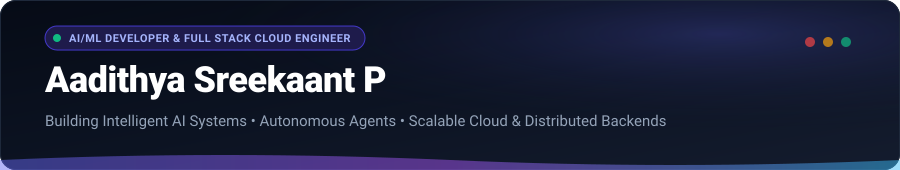

  

<h1 align="center">
  Hi there, I'm Aadithya 
</h1>

  

  
  
  
  

---

### 👨‍💻 About Me

- 🎓 **Education**: B.Tech in Computer Science & Engineering at **SRM Institute of Science and Technology** (`9.29 / 10.0 CGPA`).
- 💼 **Professional Experience**:
  - **Tata Consultancy Services (TCS)**: Software Developer Intern — Built GPU shader pixel manipulation and custom semantic search infrastructure for the *Intelligent Design Platform*.
  - **IIT Palakkad**: Machine Learning Intern — Developed a real-time highway animal detection system using **YOLOv8** & **PyTorch** (~30 FPS inference).
  - **Digital University Kerala (IIITM-K)**: Research Intern — Researched image denoising algorithms for Virtual Reality environments.
- 📄 **Research Publication**: Published peer-reviewed research on *Image Denoising Algorithm for Virtual Reality (VR) Images* (July 2024).
- 🏆 **Honors & Leadership**:
  - **1st Prize**: Inter-College Open Innovation Hackathon (AI Organ Donation & Hospital Mediation platform).
  - **1st Prize**: Inter-College Academic Poster Presentation.
  - **Co-Founder & Management Head**: *Synergy AI Club*, SRM University's intra-college AI organization.
- 🔭 **Current Focus**: Autonomous AI agents with deterministic safety guardrails, incident intelligence platforms, and high-performance full-stack architectures.

---

### 🛠️ Technologies and Tools

#### 💻 Programming Languages

  
  
  
  
  
  
  
  
  

#### 🧠 AI, Machine Learning & Computer Vision

  
  
  
  
  
  
  
  

#### ⚙️ Backend, Frameworks & Databases

  
  
  
  
  
  
  
  
  

#### ☁️ Cloud, DevOps & Tools

  
  
  
  
  
  

---

### 🚀 Featured Engineering Projects

<table>
  <tr>
    <td width="50%" valign="top">
      <h3 align="center"><a href="https://github.com/aadithyagit/recover-ai">🤖 RecoverAI</a></h3>
      

        
        
      

      
Autonomous AI Payment Recovery Agent that detects failed payments, diagnoses failure causes, and executes bounded recovery actions with deterministic guardrails and audit logging.

      <ul>
        <li><b>Deterministic Guardrails</b>: Hard-coded retry caps &amp; amount limits</li>
        <li><b>Full Stack</b>: FastAPI backend + Next.js interactive console</li>
      </ul>
    </td>
    <td width="50%" valign="top">
      <h3 align="center"><a href="https://github.com/aadithyagit/executionops">⚡ ExecutionOps</a></h3>
      

        
        
      

      
Enterprise incident intelligence system with natural language problem triage, statistical Z-score anomaly detection, root cause hypothesis testing, and risk scoring.

      <ul>
        <li><b>Two Operational Modes</b>: Quick NLU explanation + telemetry analysis</li>
        <li><b>138 Tests Passing</b> with terminal CLI analyzer &amp; Docker setup</li>
      </ul>
    </td>
  </tr>
  <tr>
    <td width="50%" valign="top">
      <h3 align="center"><a href="https://github.com/aadithyagit/private-space-booking-system">🏢 Private Space Booking System</a></h3>
      

        
        
      

      
Production-grade private space reservation platform for Chennai featuring 10 prime locations, 17 hourly slots, capacity management (max 30/slot), rate-limited authentication, and Docker Compose orchestration.

    </td>
    <td width="50%" valign="top">
      <h3 align="center"><a href="https://github.com/aadithyagit/aadithyagit.github.io">🌐 Developer Portfolio</a></h3>
      

        
        
      

      
Bespoke, high-performance personal portfolio featuring project showcases, interactive PDF certificate viewers, ErrorBoundary resilience, JSON-LD SEO, and automated GitHub Pages deployment.

    </td>
  </tr>
</table>
